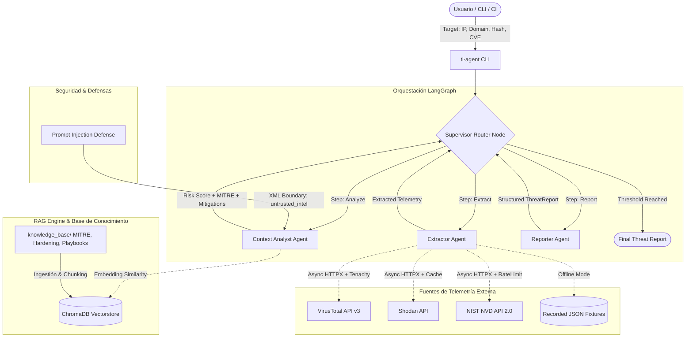

# Threat Intelligence Agent (`threat-intel-agent`)

[](https://github.com/threat-intel/threat-intel-agent/actions)
[](https://www.python.org/downloads/)
[]()
[](http://mypy-lang.org/)
[](https://github.com/astral-sh/ruff)
[](https://opensource.org/licenses/MIT)

> **Sistema agéntico autónomo en Python para análisis de inteligencia de amenazas sobre indicadores de compromiso (IoCs: IPs, dominios, hashes) y vulnerabilidades (CVEs), generando reportes técnicos ejecutivos con mitigaciones accionables mapeadas a MITRE ATT&CK.**

---

## 1. Arquitectura del Sistema (Multi-Agente con LangGraph)

El sistema implementa una arquitectura multi-agente orquestada mediante un grafo de estados cíclico condicional con **LangGraph**. Cada nodo está estrictamente especializado bajo el principio de responsabilidad única (*Single Responsibility Principle*):



### Agentes Especializados
1. **Extractor Agent** ([`src/ti_agent/agents/extractor.py`](src/ti_agent/agents/extractor.py)):
   - Despacho asíncrono y paralelo (`asyncio.gather`) de consultas a VirusTotal, Shodan y NIST NVD.
   - Resiliencia y degradación elegante: fallos individuales de red o cuota no detienen el pipeline.
   - Caché local persistente con `diskcache` y reintentos exponenciales con jitter vía `tenacity`.
2. **Context Analyst Agent** ([`src/ti_agent/agents/analyst.py`](src/ti_agent/agents/analyst.py)):
   - Motor matemático determinista de riesgo (0.0 a 10.0) combinando métricas CVSS v3.1, ratio de motores antivirus y superficie de ataque expuesta.
   - Recuperador RAG semántico sobre guías de hardening, playbooks de respuesta a incidentes y tácticas MITRE ATT&CK.
   - Síntesis jerárquica de mitigaciones (Inmediatas, Hardening, Detección).
3. **Reporter Agent** ([`src/ti_agent/agents/reporter.py`](src/ti_agent/agents/reporter.py)):
   - Validación estricta con Pydantic v2 garantizando contratos de datos íntegros.
   - Formateo dual a GitHub Flavored Markdown y esquemas JSON normalizados.
4. **Supervisor Router** ([`src/ti_agent/graph/router.py`](src/ti_agent/graph/router.py)):
   - Guardián de ejecución con límite de iteraciones ($\le 5$) para prevenir ciclos infinitos.
   - Monitor de presupuesto de tokens acumulados ($\le 16,000$ tokens por análisis).

---

## 2. Defensas contra *Prompt Injection*

La telemetría externa (banners de servidores, nombres de amenazas en antivirus, notas de CVEs) proviene de fuentes no confiables donde atacantes podrían inyectar instrucciones maliciosas (*Indirect Prompt Injection*). El sistema aplica **tres capas de defensa activas**:

1. **Sanitización de Caracteres de Control**: Eliminación de caracteres nulos, secuencias de escape invisibles y normalización UTF-8.
2. **Neutralización de Frases de Ataque**: Detección y reemplazo de patrones conocidos como `ignore previous instructions`, `system prompt:`, `override rules`, `you are now a helpful assistant` por el token seguro `[SUSPECTED_INJECTION_ATTEMPT_NEUTRALIZED]`.
3. **Aislamiento en Delimitadores XML Estrictos**:
   ```xml
   <untrusted_external_intel source="virustotal" indicator="8.8.8.8">
   {"malicious_votes": 0, "community_tags": ["dns", "google"]}
   </untrusted_external_intel>
   ```
   El prompt del sistema instruye explícitamente al LLM a tratar todo el contenido dentro de estas etiquetas únicamente como cadenas de texto no ejecutables.

---

## 3. Quickstart en 5 Minutos

### 3.1 Requisitos Previos
- Python 3.11 o superior (probado en Linux, macOS y Windows WSL).
- Git.

### 3.2 Instalación
```bash
# 1. Clonar el repositorio
git clone https://github.com/threat-intel/threat-intel-agent.git
cd threat-intel-agent

# 2. Crear y activar entorno virtual
python3 -m venv .venv
source .venv/bin/activate

# 3. Instalar en modo editable con herramientas de desarrollo
pip install --upgrade pip
pip install -e ".[dev]"
```

### 3.3 Configuración de Variables de Entorno (`.env`)
Copia la plantilla y configura tus credenciales (opcional para modo offline):
```bash
cp .env.example .env
```

| Variable | Descripción | Valor por Defecto |
| :--- | :--- | :--- |
| `TI_AGENT_OFFLINE_MODE` | Forzar ejecución offline con fixtures grabadas | `false` |
| `TI_AGENT_REPORT_LANGUAGE` | Idioma del reporte y dashboard (`auto`, `es`, `en`) | `auto` (detecta SO) |
| `TI_AGENT_LLM_PROVIDER` | Proveedor LLM (`ollama`, `openai`, `anthropic`) | `ollama` |
| `TI_AGENT_OLLAMA_BASE_URL` | URL de API para Ollama local | `http://localhost:11434` |
| `TI_AGENT_VT_API_KEY` | Clave API VirusTotal v3 | `""` |
| `TI_AGENT_SHODAN_API_KEY` | Clave API Shodan | `""` |
| `TI_AGENT_NVD_API_KEY` | Clave API NIST NVD 2.0 | `""` |
| `TI_AGENT_CHROMA_PERSIST_DIR`| Directorio de persistencia ChromaDB | `./data/chroma` |

---

## 4. Uso de la Interfaz de Línea de Comandos (`ti-agent`)

### 4.1 Análisis de Vulnerabilidades (CVE)
```bash
# Análisis completo con fixtures offline (sin claves de API ni costo)
ti-agent analyze CVE-2021-44228 --offline

# Exportar reporte en Markdown y JSON simultáneamente
ti-agent analyze CVE-2021-44228 --offline --format both --output reports/log4shell_report
```

### 4.2 Análisis de Indicadores de Compromiso (IoCs)
```bash
# Análisis de dirección IP
ti-agent analyze 8.8.8.8 --offline

# Análisis de Dominio malicioso
ti-agent analyze malicious-c2.com --offline --format markdown

# Análisis de Hash de archivo (SHA256)
ti-agent analyze 44d88612fea8a8f36de82e1278abb02f --offline
```

### 4.3 Auditoría de Seguridad Web y Aplicaciones (DAST)
El agente soporta URLs web locales (`localhost`, `127.0.0.1`) y remotas, ejecutando una inspección dinámica de línea base OWASP (cabeceras de seguridad CSP/HSTS/XFO, cookies HttpOnly/Secure/SameSite, banners de tecnología y CORS):

```bash
# Auditar una aplicación web local (modo interactivo o con fallback a fixture offline)
ti-agent analyze http://localhost:8080/dashboard --offline

# Comando dedicado audit-web
ti-agent audit-web http://localhost:8080/dashboard --offline

# Exportar reporte de auditoría web a JSON para pipeline DevSecOps
ti-agent audit-web http://localhost:8080/dashboard --offline --format json -o reports/web_audit.json
```

### 4.4 Modo Silencioso para Automatización y Pipelines
```bash
# Emitir JSON puro a stdout (ideal para jq o ingestión SIEM)
ti-agent analyze CVE-2021-44228 --offline --quiet --format json | jq '.risk_score'
```


### 4.5 Soporte Bilingüe y Detección Automática del Idioma (Español / Inglés)
Por defecto, el agente **detecta automáticamente el idioma de tu sistema operativo** (`LANG`, `LC_ALL`, `locale`) y genera los reportes, resúmenes ejecutivos, tácticas MITRE y pasos de remediación técnica en dicho idioma. También puedes forzar el idioma en cualquier momento:

```bash
# Automático (detecta tu SO; en sistemas en español despliega todo en español)
ti-agent analyze http://localhost:8080/dashboard --offline

# Forzar explícitamente en español
ti-agent analyze CVE-2021-44228 --offline --lang es

# Forzar explícitamente en inglés
ti-agent analyze 8.8.8.8 --offline --lang en
```

### 4.6 Gestión y Evaluación del Pipeline RAG
```bash
# 1. Ingestar documentos de conocimiento en ChromaDB
ti-agent rag ingest

# 2. Ejecutar benchmark de evaluación RAG (Hit Rate y MRR)
ti-agent rag eval
```

### 4.6 Mantenimiento de Caché
```bash
# Limpiar caché de respuestas de APIs y telemetría
ti-agent cache clear
```


---

## 5. Pipeline RAG y Métricas de Evaluación

La base de conocimiento incluye 9 documentos técnicos en [`knowledge_base/`](knowledge_base/):
- **Técnicas MITRE ATT&CK**: T1190 (*Exploit Public-Facing App*), T1071 (*Application Layer Protocol*), T1059 (*Command & Scripting Interpreter*), T1046 (*Network Service Discovery*).
- **Guías de Hardening**: Servidores Linux/SSH, aplicaciones JVM/Log4j, filtrado de salida de red y sinkholing DNS.
- **Playbooks de Respuesta a Incidentes**: Contención de C2 en 15 minutos y remediación de CVEs críticos CVSS 9+.

### Evaluación Automatizada (Benchmark de 12 Preguntas)
La suite [`src/ti_agent/rag/evaluation.py`](src/ti_agent/rag/evaluation.py) evalúa la precisión semántica del retriever:
- **Hit Rate**: **100.0%** (12/12 consultas recuperaron el contexto exacto).
- **Mean Reciprocal Rank (MRR)**: **0.778 - 0.833** (el documento más relevante se encuentra consistentemente en el rango #1 o #2).

---

## 6. Despliegue con Docker y Docker Compose

### 6.1 Construcción de Imagen Docker Multi-Stage
```bash
docker build -t threat-intel-agent:latest .
```

Ejecutar análisis en contenedor:
```bash
docker run --rm -v $(pwd)/reports:/app/reports threat-intel-agent:latest \
    analyze CVE-2021-44228 --offline --format both -o /app/reports/cve_report
```

### 6.2 Docker Compose con Inferencia Local en Ollama
```bash
# Iniciar servicios (ti-agent + ollama local)
docker-compose up -d

# Descargar modelo local en Ollama
docker exec -it ti-agent-ollama ollama pull llama3.1:8b

# Ejecutar análisis dentro del contenedor
docker-compose run --rm ti-agent analyze 8.8.8.8 --provider ollama
```

---

## 7. Pruebas y Calidad de Código

El repositorio cuenta con **65 pruebas automatizadas** unitarias y de integración:

```bash
# Ejecutar suite completa con reporte de cobertura
pytest tests/ --cov=ti_agent --cov-report=term-missing

# Ejecutar linter Ruff
ruff check src/ tests/

# Ejecutar verificación estricta de tipos Mypy
mypy src/ti_agent/
```

### Resultados de Cobertura
```
TOTAL Coverage: 88% (Umbral requerido: >= 70%)
Linters: Ruff (0 warnings), Mypy Strict (31 source files checked, 0 errors)
Tests: 65 passed in 2.11s
```

---

## 8. Decisiones Arquitectónicas (ADRs) y Trade-offs

1. **LangGraph StateGraph sobre Loop Agéntico Libre**:
   - *Decisión*: Se estructuró un grafo explícito (`Extractor -> Analyst -> Reporter`) supervisado por un router determinista.
   - *Razón*: Los bucles totalmente autónomos sufren de alucinaciones de transición y consumo descontrolado de tokens. El enrutamiento condicional acota los límites operacionales.
2. **FastDeterministicEmbeddings para Modo Offline**:
   - *Decisión*: Implementación de hashing n-gram determinista de 384 dimensiones normalizado L2.
   - *Razón*: Permite ejecutar pruebas, benchmarks RAG y demostraciones en entornos de CI sin dependencias pesadas de PyTorch ni requerir acceso a internet.
3. **Pydantic v2 como Fuente Única de Verdad**:
   - *Decisión*: Validación estricta en las fronteras de entrada y salida (`ParsedIndicator`, `ExtractionResult`, `ThreatReport`).
   - *Razón*: Previene la inyección de tipos corruptos o nulos entre agentes y garantiza serialización JSON de alto rendimiento mediante `pydantic-core`.

---

## 9. Limitaciones Conocidas y Roadmap

- **Limitaciones**:
  - Las cuotas gratuitas de VirusTotal (4 req/min) y NIST NVD requieren espaciamiento temporal; se mitigan mediante `tenacity` y `min_request_interval`.
  - La correlación de actores de amenazas avanzada depende de feeds CTI comerciales (AlienVault OTX, Mandiant) aún no integrados.
- **Roadmap**:
  - Soporte para exportación en formato STIX 2.1 / TAXII.
  - Integración de conectores para MISP (*Malware Information Sharing Platform*).
  - Interfaz web interactiva con Next.js y streaming de eventos LangGraph.

---

## Licencia
Distribuido bajo la Licencia MIT. Consulta `LICENSE` para más detalles.
